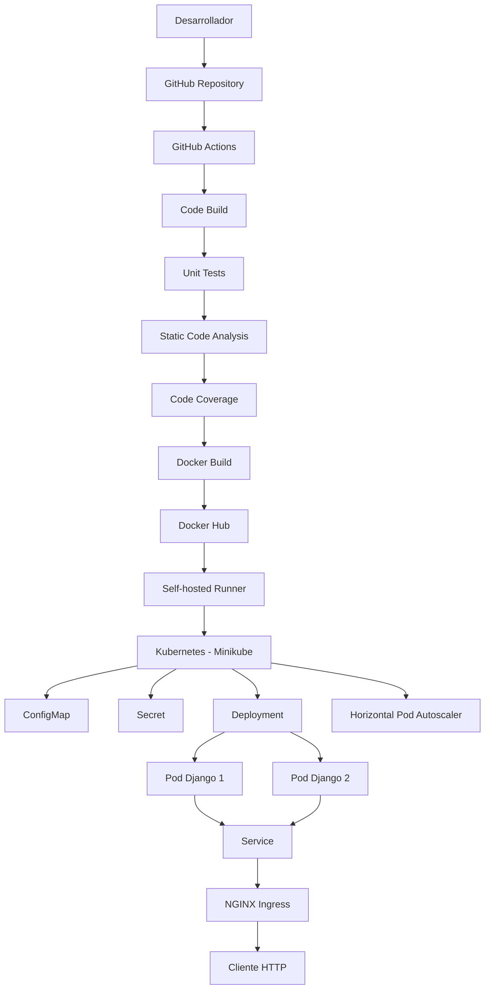

# Evaluación Técnica DevOps – Python

## 1. Descripción del proyecto

Implementación de una solución DevOps sobre la aplicación Demo DevOps Python proporcionada por Devsu.

El objetivo es automatizar el ciclo de vida de la aplicación mediante contenerización, integración y entrega continua (CI/CD), y despliegue en Kubernetes.

La solución incorpora Docker, GitHub Actions, Docker Hub y Minikube, incluyendo mecanismos de configuración, gestión de secretos, exposición HTTP y escalado horizontal automático.

## 2. Arquitectura de la solución

### Diagrama general



### Flujo de CI/CD

1. El desarrollador publica cambios en la rama `main`.
2. GitHub Actions obtiene el código fuente.
3. Se instalan las dependencias y se valida la aplicación Django.
4. Se ejecutan las pruebas unitarias.
5. Se realiza el análisis estático con Flake8.
6. Se calcula la cobertura de código.
7. Se construye y publica la imagen Docker en Docker Hub.
8. El runner self-hosted ejecuta el despliegue en Minikube.
9. Se verifica el estado de los recursos desplegados en Kubernetes.

## 3. Tecnologías utilizadas

| Componente | Tecnología |
|---|---|
| Lenguaje | Python 3.12 |
| Framework | Django 4.2 |
| API REST | Django REST Framework |
| Base de datos | SQLite |
| Contenerización | Docker |
| Orquestación local | Kubernetes / Minikube |
| Integración y entrega continua | GitHub Actions |
| Análisis estático | Flake8 |
| Pruebas y cobertura | Django Test Framework / Coverage.py |
| Registro de imágenes | Docker Hub |
| Entrada HTTP | NGINX Ingress Controller |
| Escalado automático | Horizontal Pod Autoscaler |

## 4. Estructura del repositorio

```text
.
├── api/
├── demo/
├── .github/
│   └── workflows/
│       └── ci-cd.yml
├── kubernetes/
│   ├── configmap.yaml
│   ├── deployment.yaml
│   ├── hpa.yaml
│   ├── ingress.yaml
│   ├── runner-rbac.yaml
│   ├── service.yaml
│   └── secret.yaml          # No versionado
├── .dockerignore
├── .gitignore
├── .flake8
├── Dockerfile
├── docker-compose.yml
├── manage.py
├── requirements.txt
├── requirements-dev.txt
├── README.md
└── README-original.md
```

El archivo `secret.yaml` se genera en el entorno de despliegue y está excluido del repositorio mediante `.gitignore`.

## 5. Dockerización

La aplicación se empaqueta mediante un Dockerfile basado en Python 3.12 Slim.

Se implementaron las siguientes características:

- Instalación de dependencias.
- Variables de entorno para la configuración de Django.
- Ejecución mediante un usuario no privilegiado.
- Exposición del puerto 8000.
- Healthcheck HTTP.
- Exclusión de archivos innecesarios mediante `.dockerignore`.

### Construcción de la imagen

```bash
docker build -t devsu-demo-devops-python-django-app:latest .
```

### Ejecución mediante Docker Compose

Configurar la clave de Django:

```bash
export DJANGO_SECRET_KEY="clave-local-de-prueba"
```

Levantar el servicio:

```bash
docker compose up -d --build
```

Verificar el contenedor:

```bash
docker compose ps
```

Consultar los registros:

```bash
docker compose logs -f django-app
```

La API queda disponible en:

```text
http://localhost:8001/api/users/
```

Detener el servicio:

```bash
docker compose down
```

Docker Compose utiliza un volumen persistente para almacenar la base SQLite en `/data`.

## 6. Integración y entrega continua (CI/CD)

El pipeline se encuentra definido como código en:

```text
.github/workflows/ci-cd.yml
```

Se ejecuta ante eventos `push` y `pull_request` dirigidos a la rama `main`.

### Etapas implementadas

| Etapa | Descripción |
|---|---|
| Code Build | Instalación de dependencias y validación de Django |
| Unit Tests | Ejecución de pruebas unitarias |
| Static Code Analysis | Análisis estático con Flake8 |
| Code Coverage | Medición de cobertura con Coverage.py |
| Docker Build & Push | Construcción y publicación de imagen en Docker Hub |
| Kubernetes Deploy | Despliegue automatizado en Minikube |

El trabajo de calidad se ejecuta antes de la construcción de la imagen. La publicación de Docker y el despliegue Kubernetes se ejecutan en eventos `push` sobre `main`, después de completar correctamente la etapa de calidad.

### Secretos requeridos en GitHub

Configurar en:

`Settings > Secrets and variables > Actions`

| Nombre | Descripción |
|---|---|
| `DOCKERHUB_USERNAME` | Usuario de Docker Hub |
| `DOCKERHUB_TOKEN` | Token de acceso de Docker Hub |

El despliegue utiliza un runner self-hosted registrado en el repositorio, con acceso al clúster Minikube.

La imagen se publica en Docker Hub con las etiquetas `latest` y el identificador del commit.

## 7. Despliegue en Kubernetes

El despliegue se realiza en un clúster Minikube.

### Recursos implementados

| Manifiesto | Recurso | Función |
|---|---|---|
| `configmap.yaml` | ConfigMap | Variables de configuración |
| `deployment.yaml` | Deployment | Administración de las réplicas Django |
| `service.yaml` | Service | Comunicación interna con los pods |
| `ingress.yaml` | Ingress | Acceso HTTP mediante NGINX |
| `hpa.yaml` | HorizontalPodAutoscaler | Escalado automático |
| `runner-rbac.yaml` | RBAC | Permisos limitados para el runner |
| `secret.yaml` | Secret | Clave secreta de Django; generado localmente |

### Preparación de Minikube

Iniciar el clúster:

```bash
minikube start --driver=docker
```

Habilitar los complementos:

```bash
minikube addons enable ingress
minikube addons enable metrics-server
```

### Crear el Secret

El Secret debe existir antes de desplegar la aplicación.

```bash
kubectl create secret generic django-secret \
  --from-literal=DJANGO_SECRET_KEY="$(python3 -c 'import secrets; print(secrets.token_urlsafe(50))')"
```

Este comando genera una clave aleatoria y crea el recurso directamente en Kubernetes, sin escribir la clave en el repositorio.

### Aplicación de los manifiestos

```bash
kubectl apply -f kubernetes/configmap.yaml
kubectl apply -f kubernetes/runner-rbac.yaml
kubectl apply -f kubernetes/deployment.yaml
kubectl apply -f kubernetes/service.yaml
kubectl apply -f kubernetes/ingress.yaml
kubectl apply -f kubernetes/hpa.yaml
```

El manifiesto RBAC se aplica previamente en el clúster y namespace correspondiente. El runner utiliza una cuenta de servicio con permisos limitados para administrar los recursos necesarios.

El pipeline aplica automáticamente ConfigMap, Deployment, Service, Ingress y HPA. El Secret y los permisos RBAC se preparan previamente en el clúster.

### Validación del despliegue

Consultar los recursos:

```bash
kubectl get deployments
kubectl get pods
kubectl get services
kubectl get ingress
kubectl get hpa
```

Verificar el estado del Deployment:

```bash
kubectl rollout status deployment/django-app
```

### Acceso a la aplicación

En el entorno Minikube implementado, el acceso HTTP se realiza mediante el NodePort del Ingress.

```bash
curl -i -H "Host: django.local" \
  http://$(minikube ip):32015/api/users/
```

La respuesta esperada es HTTP 200 OK.

La dirección corresponde al entorno local de Minikube y no constituye una URL pública de Internet.

## 8. Escalado horizontal automático (HPA)

Se implementó Horizontal Pod Autoscaler para ajustar automáticamente la cantidad de réplicas de Django de acuerdo con la utilización de CPU.

### Configuración

| Parámetro | Valor |
|---|---:|
| Réplicas mínimas | 2 |
| Réplicas máximas | 5 |
| Utilización objetivo de CPU | 70% |

El escalado utiliza las métricas proporcionadas por Metrics Server.

### Prueba de escalado

Se generó carga HTTP concurrente mediante un pod temporal que realizó solicitudes al servicio Django.

Resultados observados:

| Indicador | Resultado |
|---|---:|
| Réplicas iniciales | 2 |
| Utilización de CPU observada durante la carga | 361% |
| Réplicas alcanzadas | 5 |
| Utilización de CPU después de retirar la carga | 8% |
| Réplicas finales | 2 |

Se verificó el escalado automático desde 2 hasta 5 réplicas y el retorno a 2 réplicas después de retirar la carga.

## 9. Pruebas y resultados

Durante la implementación se realizaron las siguientes validaciones:

| Validación | Resultado |
|---|---|
| `python manage.py check` | Correcto |
| Pruebas unitarias | 3 pruebas aprobadas |
| Cobertura de código | 96% |
| Umbral de cobertura configurado | 90% |
| Construcción de imagen Docker | Correcta |
| Ejecución del contenedor | Correcta |
| Healthcheck Docker | Healthy |
| Acceso HTTP a la API | HTTP 200 |
| Publicación de imagen en Docker Hub | Correcta |
| Pipeline GitHub Actions | Ejecución exitosa |
| Despliegue Kubernetes | 2/2 pods disponibles al finalizar |
| Ingress | Acceso HTTP validado |
| HPA | Escalado de 2 a 5 y retorno a 2 réplicas |

### Observación sobre el análisis estático

Flake8 identifica cuatro observaciones en archivos originales de la aplicación, relacionadas con imports no utilizados y uso de importación global.

La etapa de análisis estático está configurada con `continue-on-error: true`, por lo que los hallazgos se muestran sin bloquear el pipeline. No se modificó la lógica original de la aplicación para ocultar estas observaciones.

## 10. Consideraciones y limitaciones

- Minikube se utiliza como entorno local de Kubernetes para la evaluación técnica.
- El acceso mediante Ingress está limitado a la red donde se encuentra el servidor Minikube.
- La aplicación utiliza SQLite. En Kubernetes, cada réplica dispone de su propia base de datos local dentro del contenedor; los datos no se comparten entre pods.
- El Secret de Kubernetes y las credenciales del runner no se almacenan en el repositorio.
- La aplicación utiliza el servidor de desarrollo de Django (`runserver`). La configuración está orientada a la evaluación técnica y no representa una arquitectura de producción.

## 11. Repositorios y artefactos

**Repositorio GitHub:**

https://github.com/gergarciasanchez/evaluacion-devops

**Imagen Docker Hub:**

https://hub.docker.com/r/gergarciasanchez/evaluacion-devops

---

**Proyecto:** Evaluación Técnica DevOps
**Aplicación base:** Demo DevOps Python - Devsu
